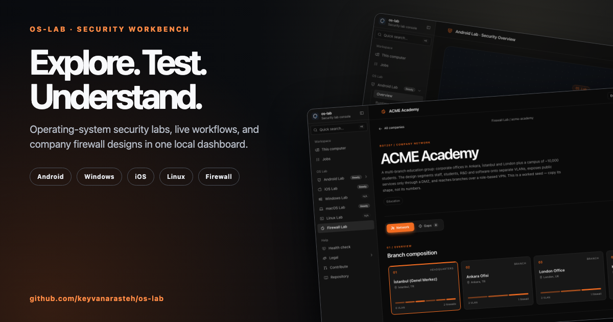
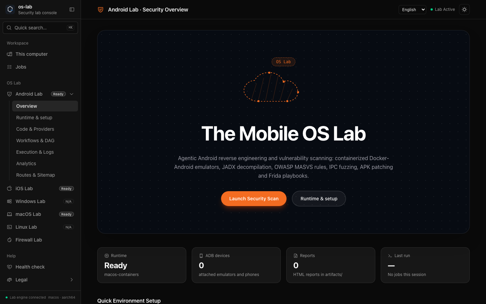
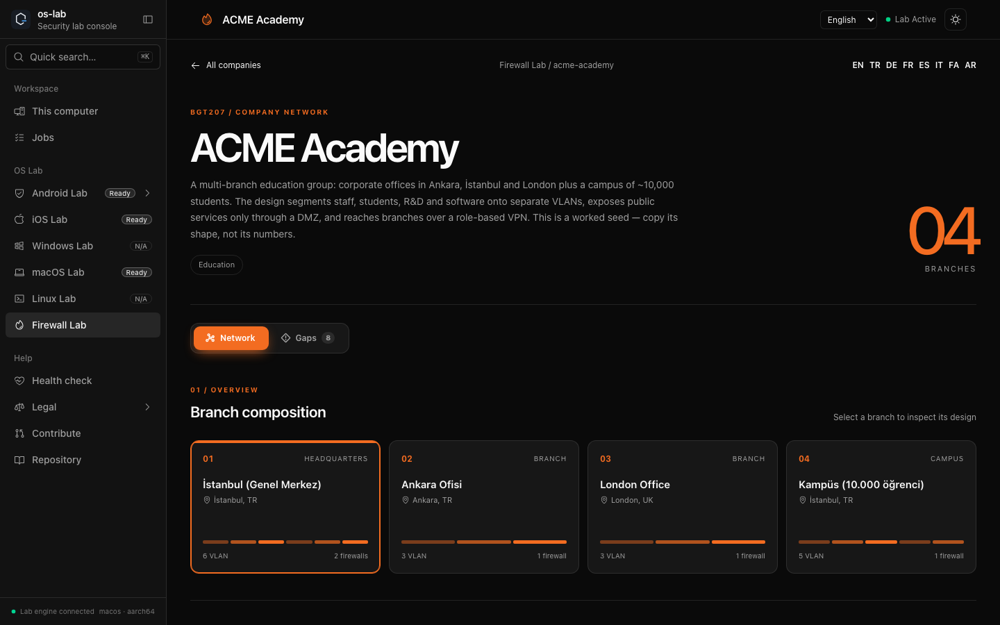
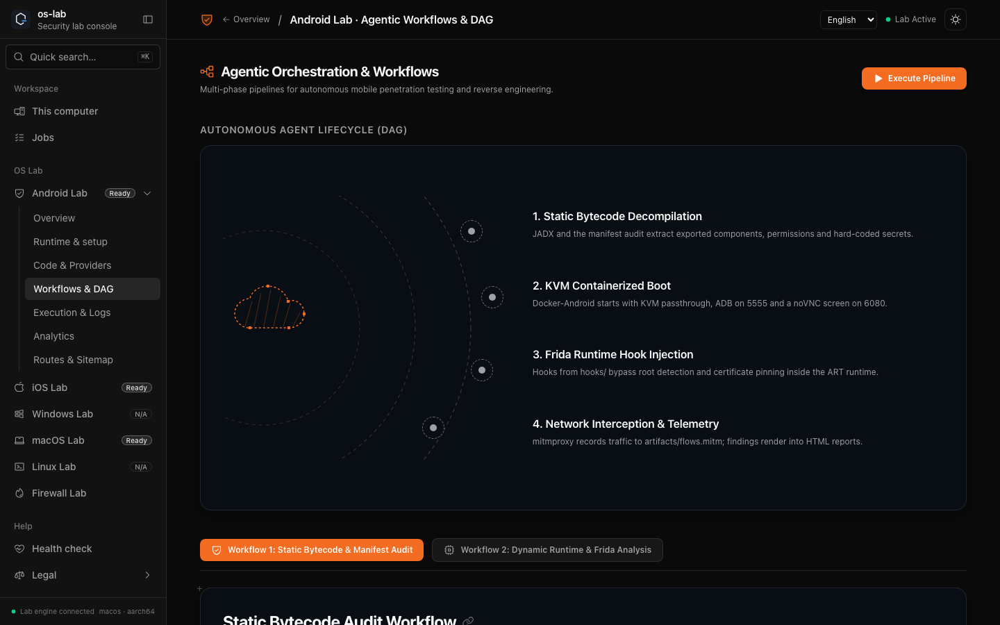
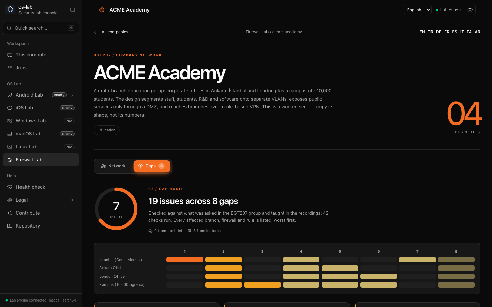

# os-lab: Windows, Android, iOS and Linux security labs on Ubuntu Server

[](LICENSE)
[](CONTRIBUTING.md)



Four research-backed, runnable operating-system security labs in one repository,
each a reproducible, isolated guest driven by `make` and a shared management CLI.

- [`win-lab/`](win-lab/) — a **Windows** VM in Docker, built on
  [`dockur/windows`](https://github.com/dockur/windows): web desktop, RDP,
  shared folder, and a Makefile for setup, boot, backup and reset.
- [`android-lab/`](android-lab/) — an **Android** security and
  reverse-engineering lab built on `budtmo/docker-android`, MobSF, mitmproxy,
  Frida and containerized RE tools, with Ubuntu, Windows zero-admin and
  KVM-free static paths.
- [`ios-lab/`](ios-lab/) — an **iOS** Simulator lab: a macOS VM in
  `dockurr/macos` on Ubuntu Server, or native Xcode / `xcrun simctl` / Appium
  on macOS.
- [`linux-lab/`](linux-lab/) — a **Linux** VM in Docker, built on
  [`qemux/qemu`](https://github.com/qemus/qemu): a disposable KVM guest for
  malware detonation, ELF RE, exploit/kernel work and container-escape practice.

All four target a headless Ubuntu Server with KVM; the Android and iOS labs also
include a native or KVM-free path where relevant.

> ⚠️ **Authorization and licensing only.** Use only Windows media and licences
> you are entitled to; Apple's EULA restricts macOS virtualization to
> Apple-branded hardware (the iOS container path is documented with that limit).
> Test only Android/iOS apps you own or have explicit permission to assess, and
> isolate any guest that runs untrusted software. See [SECURITY.md](SECURITY.md).

## One-command setup

Take a fresh machine to a running web console in a single command — detect the
host, report device status, install prerequisites, fetch/update the checkout,
provision a Python virtualenv, and launch the UI. See
[`scripts/setup/`](scripts/setup/) for details and options.

```bash
# Linux
curl -fsSL https://raw.githubusercontent.com/keyvanarasteh/os-lab/master/scripts/setup/install.sh | bash
# macOS
curl -fsSL https://raw.githubusercontent.com/keyvanarasteh/os-lab/master/scripts/setup/install-macos.sh | bash
```

```powershell
# Windows (PowerShell)
irm https://raw.githubusercontent.com/keyvanarasteh/os-lab/master/scripts/setup/install.ps1 | iex
```

Add `--report-only` (`-ReportOnly` on Windows) to inspect the host without
changing anything.

## Web console

`./labctl ui` (or the installer) opens the [dashboard](dashboard/) at
`http://127.0.0.1:5050`: what this computer is, which labs it can run and
what each still needs, one page per lab to install dependencies and start,
stop or inspect it (every action is previewed before it runs), a jobs log,
and the Android Lab workbench.

The dashboard and desktop app offer **English (default), Turkish, German,
French, Spanish, Italian, Persian and Arabic**. Choose a language from the top
bar; the desktop app starts in the system language. Each dashboard route keeps
its locale when you move between labs. Persian and Arabic use right-to-left
layout. See [translation review notes](dashboard/TRANSLATION_TODO.md) for
content that still needs a native-speaker review.

### Dashboard gallery

| Android security workbench | Firewall company network |
|:---:|:---:|
|  |  |

| Workflow view | Firewall audit |
|:---:|:---:|
|  |  |

The [Persian dashboard preview](docs/media/screenshots/firewall-persian.png)
shows the right-to-left layout. Regenerate the images from a running local
console with `scripts/capture-dashboard-screenshots.sh`.

## Legal

os-lab is licensed under the [Apache License 2.0](LICENSE). Before running the
labs, read the [Terms of Use](docs/legal/TERMS.md) and the
[Acceptable Use Policy](docs/legal/ACCEPTABLE_USE.md): only test what you own or
are authorized in writing to test, and hold valid Windows and macOS licences.
The [Privacy Notice](docs/legal/PRIVACY.md) explains what stays on your machine
(os-lab sends no telemetry and disables Docker-Android's analytics by default),
and the [Third-Party Notices](docs/legal/THIRD_PARTY_NOTICES.md) list component
licences. The dashboard shows the same documents at `/legal/`.

## Management CLI

[`./labctl`](labctl) is the single entry point for profiles, lifecycle, hardware
resize and monitoring across the Linux-host labs:

```bash
./labctl all status                        # android + win + linux at a glance
./labctl win   profile use lightweight && ./labctl win   start --wait
./labctl linux profile use lightweight && ./labctl linux start --wait
./labctl android start --wait && ./labctl android monitor
./labctl ios   start --wait                # Ubuntu macOS-VM path
./labctl linux resize --cpus 4 --ram 8G --apply
```

On macOS, the iOS lab uses the native path instead:
`make -C ios-lab mac-doctor mac-setup mac-sim mac-appium`.

`profile use` writes a preset into the lab's `.env`; `--profile P` is a one-shot
overlay. `resize` is grow-only for VM disks. Systemd units are managed with
`./labctl <lab> service install|uninstall`.

## Repo map

| Path | What it is |
|---|---|
| [`labctl`](labctl) | **Management CLI** — profiles, lifecycle, resize, monitoring, config |
| [`win-lab/`](win-lab/) | **Windows lab** — compose stack, Makefile, setup/run/backup scripts, research |
| [`android-lab/`](android-lab/) | **Android lab** — README, knowledge, cheat sheet, UI guidelines |
| [`android-lab/lab/`](android-lab/lab/) | Android runnable core — compose, Makefile, `lab.ps1`, hooks, tests, tools |
| [`ios-lab/`](ios-lab/) | **iOS lab** — macOS VM on Ubuntu, native macOS scripts, research, profiles |
| [`linux-lab/`](linux-lab/) | **Linux lab** — compose stack, Makefile, scripts, profiles, research |
| [`firewall-lab/`](firewall-lab/) | **Firewall lab** (BGT207) — a contribution lab: students PR their "dream company" network and firewall design; rendered at `/firewall/` |
| [`CONTRIBUTING.md`](CONTRIBUTING.md) · [`SECURITY.md`](SECURITY.md) · [`CODE_OF_CONDUCT.md`](CODE_OF_CONDUCT.md) | Community & process |
| [`lat.md/`](lat.md/) | Structured knowledge graph (architecture & behavior); validated by `lat check` |

## Quick starts

### Windows
```bash
cd win-lab && cp .env.example .env     # change WINDOWS_PASSWORD
sudo ./setup.sh && newgrp docker
make preflight && make boot            # web viewer http://<server-ip>:8006/
make wait-install                      # waits for storage/windows.boot
```

### Android
```bash
cd android-lab/lab && cp .env.example .env
./setup.sh && newgrp docker
make preflight && make boot            # noVNC http://<server-ip>:6080/
make wf1 APK=app.apk                   # static: MobSF + JADX
make wf2 APK=app.apk PKG=com.example   # dynamic: emulator + mitm + frida
```
No KVM? `./run.sh --static` runs a KVM-free static stack for `make wf1`.

### iOS
```bash
# Ubuntu Server (macOS VM in Docker; manual macOS/Xcode install):
cd ios-lab && cp .env.example .env && sudo ./setup.sh && newgrp docker
make preflight && make boot            # web viewer http://<server-ip>:8006/
# macOS (native):
make mac-doctor && make mac-setup && make mac-sim && make mac-appium
```

### Linux
```bash
cd linux-lab && cp .env.example .env   # pick BOOT (distro), change LINUX_PASSWORD
sudo ./setup.sh && newgrp docker
make preflight && make boot            # web viewer http://<server-ip>:8006/
make wait-ready                        # web viewer + SSH; then: make ssh
```

## Architecture

```
Windows lab                              Android lab
┌───────────────────────────┐            ┌──────────────────────────────┐
│ QEMU + KVM                │            │ android emulator (KVM)       │
│ noVNC :8006 · RDP :3389   │            │ noVNC :6080 · ADB :5555      │
│ /storage /shared /oem     │            │ MobSF :8000 · mitm :8080/8081│
└───────────────────────────┘            └──────────────────────────────┘

iOS lab (Ubuntu / macOS paths)           Linux lab
┌───────────────────────────┐            ┌──────────────────────────────┐
│ macOS VM (dockurr/macos)  │            │ Linux VM (qemux/qemu, KVM)   │
│ web :8006 · VNC :5900     │            │ noVNC :8006 · SSH :2222      │
│ or native Xcode+Simulator │            │ /storage /shared             │
└───────────────────────────┘            └──────────────────────────────┘
```

## Contributing

Issues and PRs are welcome — see [CONTRIBUTING.md](CONTRIBUTING.md), the
[issue templates](.github/ISSUE_TEMPLATE/), and the
[Code of Conduct](CODE_OF_CONDUCT.md). For vulnerabilities in the lab itself,
follow the [Security Policy](SECURITY.md).

## License

[Apache License 2.0](LICENSE). `dockur/windows` and `qemux/qemu` are MIT and do
not distribute OS media; you are responsible for valid licences and for
complying with each vendor's terms.
